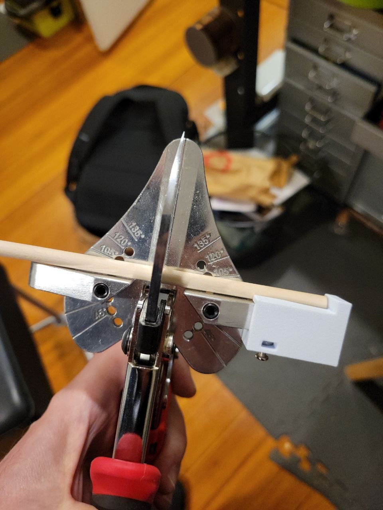

# Dowel stop for a miter shear

A 3D-printed length stop for a Gartol-style miter shear, for cutting 6 mm dowels
to 2.5" (63.5 mm). It caps the outer end of the right-hand fence, with the fence
set at 90°.



## Files

- `dowel-stop-cap.py`: parametric FreeCAD script that builds the part
- `dowel-stop-cap.FCStd`: the model, in its mounted position
- `dowel-stop-cap.3mf`: ready to slice, top plate down on the bed
- `dowel-stop-cap-preview.png`: rough render

## Use

1. Set the shear's fences to 90°.
2. Push the cap onto the end of the right-hand fence until its end wall touches
   the end of the fence. Two crush ribs give it a press fit.
3. Optional: drop an M3 nut into the slot in the top. Thread an M3 screw through
   the back wall into the nut and snug it against the fence.
4. Lay the dowel along the fence face, push it against the stop, and cut.

## Adjusting

Edit the parameters at the top of `dowel-stop-cap.py`, then rebuild:

```bash
/Applications/FreeCAD.app/Contents/Resources/bin/freecadcmd dowel-stop-cap.py
```

- `STOP_DIST`: blade-to-stop distance, which is the cut length. If the first
  cut comes out short or long, change this by the difference.
- `FENCE_LEN`: blade to the end of the fence (measured as 2").
- `DOWEL_D`: dowel diameter.
- `RIB_H`: crush rib height. Raise it for a tighter fit, lower it for a looser one.
- `WALL_Z` and `STOP_Z`: how far the walls and the stop finger stay above the
  deck.
