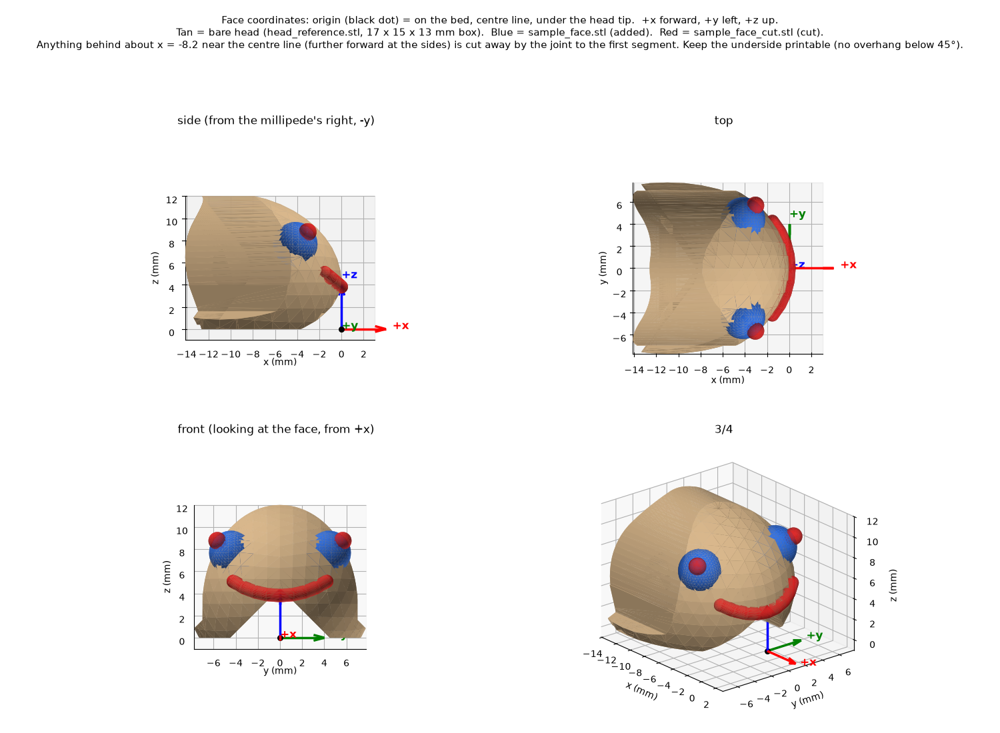

# Millipede: parametric print-in-place (Python + manifold3d)

Generates a print-in-place articulated millipede as a 3MF. Every part (head,
N body segments, tail) is a separate solid linked to its neighbours by a
captive ball joint, so it comes off the bed already assembled.


## Setup

```bash
python3 -m venv .venv && .venv/bin/pip install -r requirements.txt
```

## Usage

```bash
.venv/bin/python millipede.py                               # 26 segments, straight
.venv/bin/python millipede.py --segments 40
.venv/bin/python millipede.py --config presets/spiral.json  # 60 segments in a spiral
.venv/bin/python millipede.py --face googly --texture grooves --mouse-ears
.venv/bin/python millipede.py --help                        # every parameter
```

Output goes to `out/`: `<name>.3mf`, a `<name>.png` preview and a
`<name>.json` with the exact parameters used (pass it back with `--config` to
regenerate). Command-line flags override the config file. Each run checks that
every part is a single solid and that no two parts are closer than the
clearance; `--no-check` skips that.

## How it works

* **Nested chevron shells.** Each part's front is a "bullet" (a sphere around
  its front joint plus a 50° cone tangent to it). The back of each part is cut
  by the next part's bullet, grown by `gap` and swept through ±`yaw`. A part
  can therefore swing ±`yaw` sideways without ever touching its neighbour, and
  all the sloped faces are ≥45° so they print without supports.
* **Ball joint** at mid-height: the ball belongs to the front part and sits
  in a cavity in the next part's nose, reached through a fan-shaped slot that
  is thinner than the ball (so it can't pull out). Ball and cavity have 45°
  pointed tops and bottoms instead of flat overhangs.
* **Feet.** Two flared pads per segment (`foot_gap`, `foot_flare`,
  `foot_pad`). At the defaults each segment touches the bed with ~44 mm²,
  compared with ~27 mm² for the original 26-vertebra model. In the first
  `bottom_gap_height` mm the clearance between shells widens to `bottom_gap`
  so elephant's foot can't fuse neighbours. `--mouse-ears` adds thin discs
  under the head and tail.
* **Layouts** (`layouts.py`) only supply joint points spaced `pitch` apart.
  The spiral is Archimedean, tail in the middle, and its inner radius is
  chosen so that no joint is bent more than `spiral_bend_fraction` × `yaw`.

## Trade-off: yaw vs. feet vs. spiral tightness

How much a joint can bend also sets how tight a spiral can be, and more bend
means more material carved from the outer ends of the feet:

| yaw | foot area / segment | tightest spiral radius |
|----:|--------------------:|-----------------------:|
| 12° (default) | 44 mm² | 33 mm |
| 16° | 39 mm² | 25 mm |
| 18° (spiral preset) | ~37 mm² | 22 mm |
| 20° | 34 mm² | 20 mm |
| 25° | 27 mm² (thin outer toes) | 16 mm |

## Extending

* **Faces in code**: `faces.py`. A face returns `(add, subtract)` solids in
  head coordinates; register it in `FACES`. To make a mesh face permanent, add
  e.g. `FACES["robot"] = mesh_face("face_meshes/robot.stl", "face_meshes/robot_cut.stl")`.
  For faces designed in a CAD tool, see "Designing your own face" below.
* **Textures**: `textures.py`. A texture takes a part and returns it modified
  (`grooves`, `spots` and `bumpy` are the examples). Keep cuts shallow and away from
  the front/back faces, joint and feet. Textures in `PER_SEGMENT` are rebuilt
  for every segment (e.g. random patterns); others are built once and reused.

## Faces (`--face`)

| option | what it is |
|---|---|
| `eyes` (default) | two domed eyes (1.8 mm radius) on the front of the head, each with a dimple pupil |
| `googly` | bigger domed eyes (2.4 mm), set a little closer together and higher |
| `dimple_eyes` | engraved eyes only, nothing sticks out; the safest to print |
| `none` | plain rounded head |

### Designing your own face



Model a face in any CAD tool and pass it in as mesh files (STL, 3MF or OBJ):

* `--face-mesh file.stl` is **added** to the head (eyes, horns, a nose...)
* `--face-cut file.stl` is **cut** from it (pupils, a mouth, engraved patterns)

Draw them in **face coordinates**: origin on the bed (z = 0), on the centre
line (y = 0), directly under the tip of the head. +x points forward out of the
face, +y to the millipede's left, +z up, in millimetres. Both meshes must be
closed (watertight) solids.

`face_meshes/` has everything needed to start:

| file | what it is |
|---|---|
| `head_reference.stl` | the bare head in face coordinates; import it into your CAD tool and model against it |
| `sample_face.stl` | example add mesh: two domed eyes |
| `sample_face_cut.stl` | example cut mesh: pupils and a smile |
| `face_guide.png` | the picture above |

Try the sample (use `--face none` so the built-in eyes don't get in the way):

```bash
.venv/bin/python millipede.py --face none --face-mesh face_meshes/sample_face.stl --face-cut face_meshes/sample_face_cut.stl
```

Things to keep in mind:

* Anything behind about x = -8 near the centre line, and further forward at
  the sides, is cut away by the joint to the first segment.
* Keep features printable without supports: nothing on the underside that
  overhangs more than 45°, and nothing narrower than about 0.8 mm.
* The head's shape depends on `width`, `height`, `head_length`, `pitch` and
  `foot_flare`. If you change those, regenerate the reference files with the
  same values: `.venv/bin/python face_guide.py --config my_params.json`
  (or the same flags you build with; `--out-dir` writes them elsewhere).

## Textures (`--texture`)

Textures apply to the body segments only, not the head or tail.

| option | what it is |
|---|---|
| `none` (default) | smooth shells |
| `grooves` | one groove (0.6 mm deep, 0.8 mm wide) across the top of each segment, following the chevron |
| `spots` | three rows of shallow oval dimples (2.2 mm across, 0.45 mm deep): one down the spine and one along each side, the same on every segment |
| `bumpy` | densely packed small bumps of random size (0.7–1.5 mm across), different on every segment; adds ~0.7 mm to the height. Bumps have 45° cones underneath so the ones on the sides print without supports |

Faces and textures combine freely, e.g. `--face googly --texture spots`.

To tune `spots` or `bumpy` (spot size and position; bump size range, how far
bumps stick out, how tightly they pack), change the keyword defaults of
`spots()` / `bumpy()` in `textures.py`.

## All parameters

Lengths in mm, angles in degrees. On the command line, underscores become
dashes (`foot_flare` → `--foot-flare`); on/off options take `--name` /
`--no-name` (e.g. `--mouse-ears`, `--no-preview`). In a `--config` JSON file
use the underscore names.

**Overall**

| parameter | default | notes |
|---|---:|---|
| `segments` | 26 | body segments between head and tail |
| `layout` | `line` | `line` or `spiral` |
| `name` | auto | output file stem, e.g. `millipede-26seg-line` |

**Body shape**

| parameter | default | notes |
|---|---:|---|
| `pitch` | 5.2 | joint-to-joint distance; the original was 4.64 |
| `width` | 14 | body width, not counting the foot flare |
| `height` | 12 | total height |
| `leg_height` | 3 | height of the legs below the domed body |
| `chevron_angle` | 50 | cone half-angle of the nested shells; keep ≥45 to avoid overhangs |

**Feet**

| parameter | default | notes |
|---|---:|---|
| `foot_gap` | 2 | gap between left and right foot (0 = one wide foot) |
| `foot_flare` | 1 | how far each foot pad sticks out past the body side |
| `foot_pad` | 0.6 | vertical edge of the pad before its 45° chamfer |
| `mouse_ears` | off | thin discs under head and tail for adhesion |
| `ear_radius` | 6 | |
| `ear_thickness` | 0.4 | |

**Joint and clearances**

| parameter | default | notes |
|---|---:|---|
| `ball_radius` | 1.2 | |
| `neck_radius` | 0.6 | must stay below `ball_radius` − `clearance` − 0.15 so the ball is captive |
| `nose_wall` | 0.9 | wall between the ball cavity and the front surface |
| `clearance` | 0.35 | ball/cavity and neck/slot clearance |
| `gap` | 0.45 | clearance between nested shells |
| `bottom_gap` | 0.7 | shell clearance in the first layers (against elephant's foot) |
| `bottom_gap_height` | 0.4 | how high the wider `bottom_gap` reaches |
| `yaw` | 12 | sideways bend allowed per joint; see the trade-off table above |
| `joint_height` | 0 | ball height; 0 = middle of the domed body |

**Head, tail and decoration**

| parameter | default | notes |
|---|---:|---|
| `head_length` | 11 | from the first joint behind the head to its tip |
| `tail_length` | 8 | from the tail's front joint to its tip |
| `face` | `eyes` | see Faces |
| `face_mesh` | none | mesh file in face coordinates to add to the head |
| `face_cut` | none | mesh file in face coordinates to cut from the head |
| `texture` | `none` | see Textures |

**Spiral layout**

| parameter | default | notes |
|---|---:|---|
| `spiral_inner_radius` | 0 | 0 = the tightest radius `yaw` allows |
| `spiral_turn_gap` | 2 | clearance between neighbouring turns |
| `spiral_bend_fraction` | 0.75 | use at most this fraction of `yaw` when laying out the spiral |

**Output**

| parameter | default | notes |
|---|---:|---|
| `resolution` | 48 | segments per full circle |
| `out_dir` | `out` | |
| `stl` | off | also write an STL |
| `preview` | on | write a PNG preview |
| `check` | on | check every part is one solid and no parts touch |

The generator refuses parameter combinations that can't work (e.g. a wall
behind the ball cavity thinner than 0.6 mm, or a ball that isn't captive) and
says which values to change.

The default `clearance` (0.35) and `gap` (0.45) come from a test print. On a
different printer or filament, print a short one first (`--segments 6`) and
adjust them.
